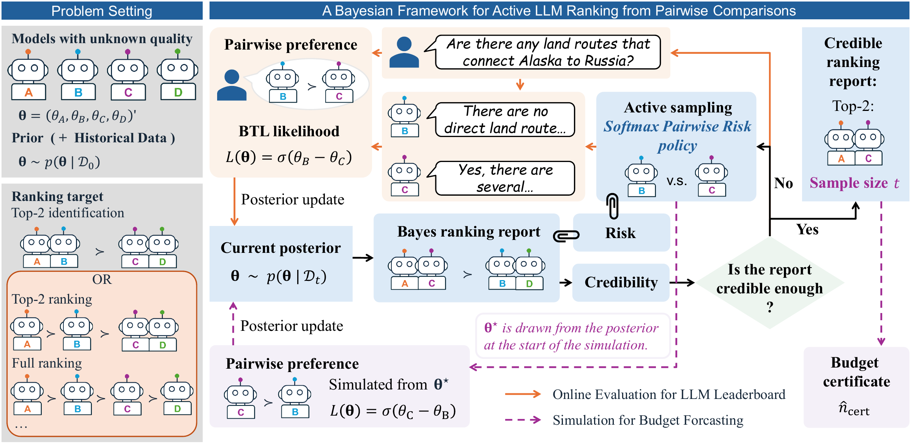
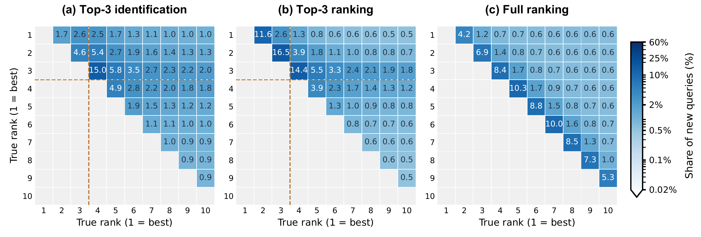

# Bayesian Active Ranking Simulation Toolkit

### Design pairwise-comparison experiments and explore ranking uncertainty

**Muting He · Pangpang Liu · Will Wei Sun**

[Framework](#framework) · [Quick start](#quick-start) · [Design an experiment](#design-an-experiment) · [Configuration](docs/configuration.md) · [Visualizations](#visualizations) · [Policies](#policies)

A configurable Python toolkit for simulating **Bayesian active ranking from
pairwise comparisons**. Choose the number of models, ranking targets,
acquisition policies, repetitions, historical observations, and comparison
budget, then inspect ranking risk, credibility, recovery, and query allocation.

The toolkit accompanies *Bayesian Active Ranking from Pairwise Comparisons:
A Unified Framework for LLM Leaderboards*.
[Read the manuscript](manuscript/Bayesian%20Active%20Ranking.pdf).

## Framework

Pairwise judgments update a joint posterior over model qualities.
A Bayes report minimizes posterior expected normalized Kemeny distance for the
requested ordered partition. Posterior credibility quantifies support for that
report, while **Softmax Pairwise Risk (SPR)** prioritizes pairs contributing
more to its current ranking risk.

  

*Figure 1 from the paper. This diagram also illustrates credible stopping and
budget forecasting. The simulation runner evaluates acquisition policies at a
user-selected fixed comparison budget.*

Synthetic observations follow the Bradley–Terry–Luce model,

$$
\Pr(Y=1\mid i,j,\boldsymbol{\theta})
=\sigma(\theta_i-\theta_j),\qquad
\sigma(x)=\{1+\exp(-x)\}^{-1}.
$$

Inference uses a zero-mean independent Gaussian prior with configurable scale,
a Gaussian Laplace posterior approximation, and scrambled Sobol integration.
Full-ranking Bayes reports and ranking risks have analytic computations.

## Quick start

From the repository root, use Python 3.11 or newer and install the dependencies.

~~~bash
python -m pip install -r requirements.txt
python run.py --smoke
~~~

The smoke check runs one replicate and up to ten new comparisons for each
scenario-policy combination in `configs/example.toml`. Open

~~~text
results/smoke_example/report/index.html
~~~

to inspect the generated report.

For a small experiment with uncertainty intervals, choose your own repetition
count and budget.

~~~bash
python run.py --replicates 10 --budget 100 --jobs 2 --output results/my-first-run
~~~

For an isolated environment, run `python -m venv .venv` first and use
`.venv/bin/python` on Linux/macOS or `.venv\Scripts\python.exe` on Windows
for installation and execution.

## Design an experiment

Copy a configuration and edit the settings you need.

~~~bash
python run.py --config configs/example.toml --output results/my-experiment
~~~

This complete example compares SPR and Uniform for top-3 identification
among eight models.

~~~toml
[experiment]
seed = 42
replicates = 30
max_comparisons = 400
evaluation_budgets = [50, 100, 200, 400]
policies = ["softmax_pair_risk", "uniform"]
initial_comparisons_per_pair = 0
spr_c = 20.0
jobs = 2

[inference]
sigma0 = 1.0
posterior_samples = 4096

[[scenarios]]
name = "my_top3"
n_models = 8
cut_points = [3, 8]
truth_mode = "prior_predictive"
~~~

Save it as `configs/my-experiment.toml` and run

~~~bash
python run.py --config configs/my-experiment.toml --output results/my-top3
~~~

One episode is one policy applied to one scenario in one replicate.
For example, two policies, three scenarios, and 30 replicates produce 180
independent episodes. Methods within a replicate share simulated inputs.

### Choose a ranking target

`cut_points` gives the final position of each group. The initial zero in the
paper's mathematical notation is implicit.

| Target for eight models | `cut_points` | Interpretation |
|---|---|---|
| Top-3 identification | `[3, 8]` | Identify the leading set of three. |
| Ranking within top-3 | `[1, 2, 3, 8]` | Identify and order the leading three. |
| Full ranking | `[1, 2, 3, 4, 5, 6, 7, 8]` | Order every model. |
| Three ordered tiers | `[2, 5, 8]` | Report groups of sizes 2, 3, and 3 in order. |

Add multiple `[[scenarios]]` sections to evaluate several targets in one run.
When changing `n_models`, update the cut points so their last entry equals the
model count. General ordered-partition reporting uses exact optimization over
the posterior integration sample, so its cost grows with the report space.

### Choose data and initial information

- `truth_mode = "prior_predictive"` draws true qualities independently from the
  Gaussian distribution using the scenario's prior scale.
- `truth_mode = "fixed_grid"` generates spaced qualities and randomly permutes
  their model identities. `boundary_gap` and `within_gap` control adjacent gaps.
- `initial_comparisons_per_pair = 0` gives a cold start. A positive value
  generates that many historical judgments for every unordered pair. With
  `M` models and `h` initial judgments per pair, there are `h*M*(M-1)/2`
  initial observations, additional to `max_comparisons`.

The supplied configurations illustrate different uses.

| Configuration | Starting point |
|---|---|
| `configs/example.toml` | Eight models, three ranking targets, SPR and Uniform. |
| `configs/ordered-partition.toml` | Six models in three ordered tiers, fixed-grid qualities, and historical data. |
| `configs/full-ranking.toml` | Ten models with the full-ranking comparison policies. |
| `configs/paper/` | Optional larger configurations from the paper. |

### Override common settings

~~~bash
python run.py --config configs/example.toml --replicates 50 --budget 500 --spr-c 10 --seed 123 --jobs 4 --output results/custom
~~~

Command-line values override the TOML file. `--budget` removes intermediate
evaluation budgets beyond the new maximum, and the terminal budget is always
summarized. Other settings, including the policy list and model count, are
edited in TOML.

| Option | Effect |
|---|---|
| `--config FILE` | Load a TOML configuration, default `configs/example.toml`. |
| `--replicates N` | Choose the repetition count. |
| `--budget N` | Choose new comparisons per episode. |
| `--spr-c C` | Choose the nonnegative SPR inverse temperature. |
| `--seed N` | Choose the nonnegative master seed. |
| `--jobs N` | Choose parallel worker processes. |
| `--output DIR` | Choose where generated files are written. |
| `--smoke` | Use one replicate and a short complete-batch budget. |
| `--report-only` | Rebuild an existing run's report. |

See the [complete configuration reference](docs/configuration.md) for every
experiment, inference, and scenario parameter, its default, and valid values.

## Policies

Each policy supplies the next pair. Its observation enters the common posterior,
reporting procedure, and evaluation metrics.

| Configuration key | Method | Acquisition idea |
|---|---|---|
| `softmax_pair_risk` | SPR | Sample with weight `exp(c * pairwise_risk)`. |
| `uniform` | Uniform | Sample an unordered pair uniformly. |
| `active_ranking` | AR | Borda sampling and confidence-based elimination. |
| `hamming_lucb` | Hamming-LUCB | Compare uncertain top-k and outside candidates with random opponents. |
| `topk_aware` | Top-k-aware | Combine outcome uncertainty, score variance, and membership entropy. |
| `tournament_heap` | TOP | Repeated tournament and heap extraction. |
| `akg` | AKG | Expected gain in full-ranking accuracy with Dirichlet moment matching. |
| `quicksort` | Repeated Quicksort | Random-pivot sorting with fresh observations. |
| `bayes_entropy` | Bayes-Entropy | Expected information gain from the Gaussian belief. |
| `d_opt` | D-optimal | Fisher log-determinant gain from a separate BTL fit. |

SPR and Uniform support all implemented ranking targets. AR supports prescribed
partition sizes. Hamming-LUCB and Top-k-aware require a two-group top-k
identification target. TOP supports top-k identification, top-k ranking, and
full ranking. AKG, Quicksort, Bayes-Entropy, and D-optimal are the full-ranking
comparisons used in the paper.

Use a scenario's optional `policies` list to select a subset of the global
list when different targets need different comparisons. The
[method reference](docs/references.md) explains acquisition states,
historical-data initialization, and adaptations.

## Metrics

| Metric | Meaning |
|---|---|
| Average ranking risk | Mean posterior expected normalized Kemeny distance immediately before each new comparison. Lower is better. |
| Terminal ranking credibility | Posterior probability that the final report's distance from the true target is at most `epsilon`. With `epsilon=0`, this is exact-partition probability. |
| Terminal exact recovery | Indicator that the final report equals the simulated true partition. The replicate mean is the exact recovery rate. |
| Query-selection time | Mean milliseconds per selection over a configurable query window and replicate subset. |

For single-judgment updates, average ranking risk at budget `N` is
$N^{-1}\sum_{t=0}^{N-1}R_t$. Batched experiments weight each pre-batch risk by
the number of new judgments. Confidence intervals use Student-$t$ intervals
for mean risk and credibility and Wilson intervals for recovery.
A single-replicate run shows means and omits undefined Student-$t$ intervals.

`timing_replicates` chooses the final replicate IDs used for timing.
`timing_queries` chooses the first acquisition steps used from each of those
replicates. Both are clipped to the amount of data available. Timing starts
with the posterior and report available and ends when a pair is returned.

## Visualizations

Every completed run generates an HTML report, a Markdown report, PNG/PDF figures,
and CSV summaries.

~~~text
results/my-experiment/report/index.html
results/my-experiment/report/results.md
results/my-experiment/report/figures/
~~~

### Ranking trajectories

The three panels show ranking risk, ranking credibility, and exact recovery
as new comparisons accumulate. Lines average across replicates, with
pointwise 95% intervals. By default, risk curves display the **current state**.
Tables always report path-average risk.

~~~bash
# Rebuild current-state risk trajectories from saved results.
python make_report.py results/my-experiment

# Display path-average risk trajectories.
python make_report.py results/my-experiment --risk average
~~~

Both commands use saved results. The average-risk version gets a distinct
figure filename, and the HTML/Markdown report links to the selected view.

### Query-allocation heatmaps

Heatmaps align each replicate's models by true quality rank, with rank 1 best.
Each unordered pair appears once in the upper triangle. Colors and cell labels
show the percentage of acquired queries allocated to that pair. Dashed lines
mark target partition boundaries. Cell labels are shown for up to 15 models.

  

*Figure 2 from the paper illustrates how query allocation changes with the
ranking target. Your run generates heatmaps for its own targets, policies,
model counts, and observations.*

Use `report/trajectory_summary.csv` and `report/query_allocation.csv` for
custom figures. The [visualization guide](docs/visualization.md) describes
the columns and provides a plotting example.

## Outputs and resumption

| Output relative to the run directory | Contents |
|---|---|
| `summary.csv` | Terminal metric means, intervals, timing, and replicate counts. |
| `budget_summary.csv` | Statistics at intermediate and terminal budgets. |
| `budget_runs.csv` | Metrics for individual replicates at each budget. |
| `runs.csv` | Episode metrics, seeds, true scores, and initial-data information. |
| `trajectories.csv.gz` | Every state, ranking report, query, and observation. |
| `report/trajectory_summary.csv` | Mean curves and pointwise intervals. |
| `report/query_allocation.csv` | Query fractions aligned by true quality rank. |
| `report/audit.json` | Shared-input, observation replay, budget, and metric checks. |
| `manifest.json` | Full configuration and package version. |
| `episode_checkpoints/` | Compressed completed episodes. |
| `query_checkpoints/` | States for interrupted episodes. |

Repeat the same command and output directory to resume an interrupted run.
Worker count, checkpoint cadence, and timing-summary settings can be changed.
Use a separate output directory when changing scientific settings such as the
model count, policies, repetitions, budget, or SPR parameter.

## Paired comparisons

Methods in a replicate share true scores, initial observations, observation
uniforms, and the Sobol integration design. At time `t`, the selected pair
determines how the shared uniform is converted into a simulated judgment.
Policy-selection streams use stable method coordinates.

Give scenarios the same `pairing_id` when they should share those random
inputs. The same ID and the same data-generating settings pair different
ranking targets. Reuse the seed, model count, and pairing IDs when comparing
different SPR temperatures in separate output directories.

## Code map

~~~text
run.py                        Configurable simulation entry point
make_report.py                Reports and visualization
configs/                      Editable examples and optional paper presets
docs/                         Parameter, visualization, and policy guides
anytime_ranking/
  experiment.py               One sequential simulation episode
  belief.py                   Gaussian Laplace inference
  ranking.py                  Bayes reports, risk, and credibility
  report_optimizer.py         Ordered-partition report optimization
  policies/                   Acquisition algorithms
  runner.py                   Parallel execution and resumption
  reporting.py                Metrics and confidence intervals
~~~

~~~bash
python -m unittest discover -s tests
~~~

